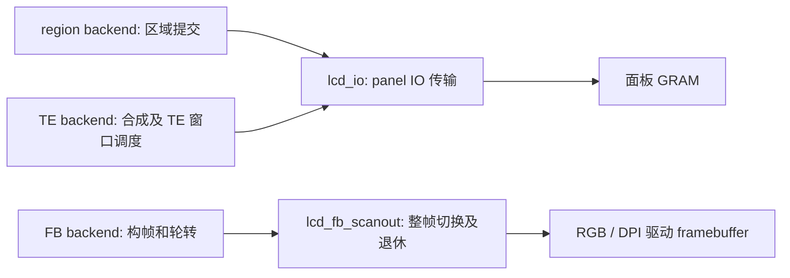

# Present 模式、缓冲策略与输出适配

RGB/MIPI 统一走 scanout，并要求至少两张驱动 framebuffer。非防撕裂 NONE 更新路径及其专用 `lcd_fb_update` 模块已移除；GRAM/TE 保持现有行为。

## 三层各管什么

| 层 | 名称 | 职责 |
|---|---|---|
| 前端输入合同 | PARTITION / FULL / DIRECT | 前端每次交付 tile、完整帧或整帧缓冲内的脏区域 |
| backend 策略 | region / FB / TE | 决定像素如何排队、合成和提交，以及何时归还资源 |
| LCD adapter | lcd_io / lcd_fb_scanout | 调用具体驱动、注册回调，并把驱动完成转换为内部事件 |

PARTITION 输入不等于 region backend：FB PARTIAL 和 TE 同样接收 PARTITION。PARTIAL 也不表示区域被直接发送到屏幕；在 FB backend 中，它先参与完整 candidate framebuffer 的构建。



region 管 tile 租用、转换、传输排队和源回收，不假设硬件有 GRAM。FB 管完整图像、脏区补全及 framebuffer 轮转。TE 管图像合成、TE 窗口和发送预算；其策略不能简单合并为 region 加一个等待 GPIO。

## 公开模式实际走向

| 面板 | 公开模式 | 输入合同 | backend → adapter | 完整缓冲与显示策略 |
|---|---|---|---|---|
| RGB / DSI | DOUBLE_FULL / TRIPLE_FULL | FULL | FB → lcd_fb_scanout | 2/3张 FB；提交完整新帧并等待扫描交接 |
| RGB / DSI | DOUBLE_DIRECT | DIRECT | FB → lcd_fb_scanout | 2张完整 FB；直接绘制脏区并做必要的图像补全 |
| RGB / DSI | DOUBLE_PARTIAL / TRIPLE_PARTIAL | PARTITION | FB → lcd_fb_scanout | tile 写入 candidate，补全未更新区域，再切换2/3张完整 FB |
| Panel IO | NONE | PARTITION | region → lcd_io | 逐区域传输到面板；不承诺防撕裂 |
| Panel IO + 有效 TE | TE_SYNC | PARTITION | TE → lcd_io | 合成图像并按 TE 时序准入发送；效果取决于面板时序和传输预算 |

RGB / DSI 不支持 TE_SYNC；Panel IO 不支持这些 FB FULL / DIRECT / PARTIAL 模式。AUTO 在公开目标解析中，RGB / DSI 根据实际驱动池优先选 TRIPLE_PARTIAL（三张）或 DOUBLE_PARTIAL（两张），一张明确报不支持；未提供驱动句柄的预算查询默认建议三张，具备有效 TE 配置的 IO 选 TE_SYNC，其他 IO 选 NONE。AUTO 是解析策略，没有第四种 backend。

公开和内部 engine 均拒绝 scanout NONE；GRAM 的 NONE、TE 及其 AUTO 解析保留。创建时核对真实驱动资源，AUTO 不分配额外 FB，也不在运行时轮流测分或切换 backend。

## 两种完成绝不能混用

| adapter | 完成依据 | 可以归还什么 | 不表示什么 |
|---|---|---|---|
| lcd_io | IO color transfer done | 本次传输的源像素 | 面板已经扫描显示完整图像 |
| lcd_fb_scanout | 经验证的 framebuffer 完成协议 | 在 backend 确认交接后退休的旧 FB | 不能用普通源拷贝完成或任意 VSYNC 替代 |

FB 路径中 tile 可以在复制完成后归还，但 framebuffer 仍必须留到扫描退休。RGB bounce、S31 请求式切链与 DSI 的具体协议由 scanout 适配器内部解析，用户不选择 `rgb.scanout`；详见 [RGB handoff](../dev/test_apps/rgb_handoff/README.md)。

## 命名边界

region 与 FB、TE 的职责保持分离；删除 fb_update 后，输出适配器只保留 lcd_io 和 lcd_fb_scanout。历史命名与性能记录保留当时源码和哈希。

`CONFIG_ESP_DISPLAY_PRESENT_GRAM_BACKGROUND` 及其 PRIORITY 配置键保留，避免既有 sdkconfig 失效；它们是沿用的配置名字，不表示第四种策略。历史性能报告和证据保留当时名称与哈希。LCD 适配器统一为 lcd_io、lcd_fb_scanout；这些内部改名不扩展硬件支持范围。

## 平台模块分组与 TE 边界

```text
platform/
├── lcd/
│   ├── present_lcd_io          panel IO 区域传输（目前 SPI/QSPI）
│   ├── present_lcd_fb_scanout  RGB/DPI framebuffer 扫描交接
│   └── present_lcd_rgb_info    RGB 实际配置与能力事实解析
├── te/
│   ├── present_te_sync        GPIO 测量、准入及唤醒协调
│   ├── present_te_timing      发送窗口计算
│   └── present_te_timer       平台定时器及回调生命周期
└── present_os                 通用 OS 抽象
```

TE sync 是同步服务，与两个 LCD 输出适配器不并列。TE backend 使用 lcd_io 输出像素，另用 TE 服务决定发送时机。

te_timing 与 te_timer 保留分离：前者是纯函数，根据周期、扫描时长、传输时长和当前相位计算允许窗口及下一次开放时间，不分配资源、不操作 GPIO 或 OS 定时器；后者封装 IDF esp_timer / Host pthread，负责 deadline、唤醒及带超时的回调退出等待。合并会让纯窗口计算引入平台和生命周期依赖，减少文件数但没有消除重复职责。

te_sync 和 TE backend 均调用这两个模块：前者协调真实 GPIO 测量，后者也可处理直接提供的时序模型。它们不是仅供 te_sync 使用的私有实现。窗口计算和定时器销毁分别验证，保留测试及错误处理边界。

## LVGL 借用缓冲

FULL 零拷贝及原生双缓冲 DIRECT 先取得租约，再挂载 LVGL 描述符，不再分配全屏占位像素。后续通过 REFR_REQUEST 在 LVGL 的入口缓冲检查前准入；只有描述符和 DIRECT 同步历史保留，提交/取消前撤销借用像素引用。错误时暂停刷新，不在已交还的 FB 上继续绘制。

旋转 DIRECT 的复制路径仍持有实际增量绘图画布。PARTIAL 的小块回退 tile 保留用于帧中途准入失败；LVGL 的 FLUSH_WAIT_START 回调失败不能中断当前绘图分段，因此不能按 FULL 的方式直接置空该存储。运行时旋转在这两种所有权方式之间创建或释放真实画布；关闭先撤销 LVGL 引用再取消租约。

此前性能网页记录的是相应历史提交；本次 0°/90° 的定向回归和内存变化见[回归记录 (archive)](../dev/ARCHIVE.md)，不把旧成绩标成新的完整性能矩阵。

## PPA 请求准入

执行器选择仍先 probe，再执行。P4 SRM 多宏块请求若尾部载荷等于 192-byte FIFO 边界，probe 返回不支持，由既有 CPU fallback 执行；已经交给硬件的任务不做 CPU 重试。该约束在干净 IDF 的 `131×352` RGB565 修补复制中复现挂起，邻近宽度正常，验证与计算依据见上述记录。宏块高度由当前编译的 P4 版本决定，Host 覆盖 16/32 两种情形；其他目标沿用原准入规则。没有新增配置、后台任务或像素存储。
