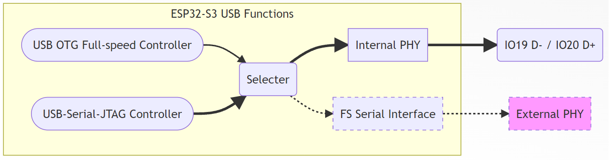
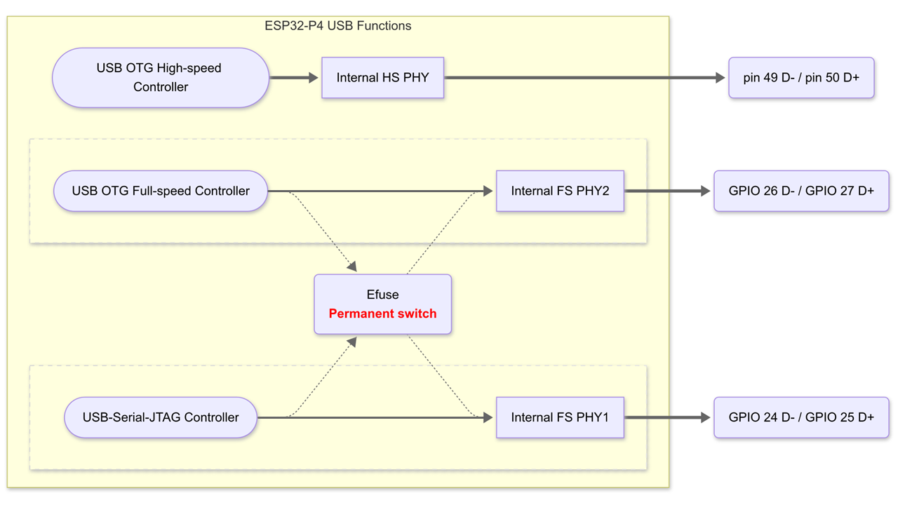
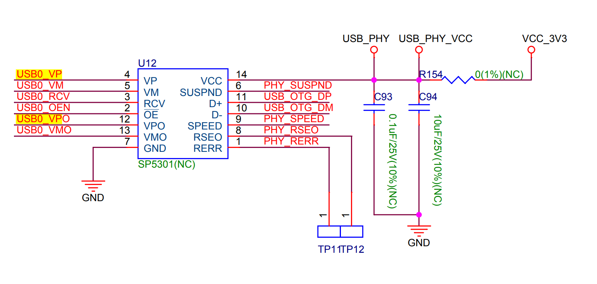

USB PHY/Transceiver Introduction
---------------------------------

:link_to_translation:`zh_CN:[中文]`

The function of the USB PHY/Transceiver is to convert the digital signals from the USB controller into USB bus signal levels, providing bus driving capability, and detecting receive errors, among other functions. Chips like ESP32-S2/S3/P4 have a built-in USB Full-speed PHY, allowing users to directly use the USB D+ D- pins specified by the chip for communication with an external USB system. Additionally, ESP32-P4 has a built-in USB High-Speed PHY. ESP32-S2/S3 retains an external PHY extension interface, allowing users to connect an external PHY when needed.

Use the internal PHY
^^^^^^^^^^^^^^^^^^^^^^^^^^^^^^^^^^^^^^^^^

The ESP32-S2/S3/C3 internally integrates a USB PHY, eliminating the need for an external PHY chip. It can directly connect to external USB hosts or devices through the USB D+/D- pins. On ESP32-S3, the USB-OTG and USB-Serial-JTAG controllers share a single internal PHY, so only one controller can use it at a time.

The internal USB-PHY corresponds to fixed GPIO pins, as shown in the table below:

.. list-table::
   :header-rows: 1

   * -
     - D+
     - D-
   * - ESP32-S2
     - 20
     - 19
   * - ESP32-S3
     - 20
     - 19
   * - ESP32-C3
     - 19
     - 18
   * - ESP32-C6
     - 13
     - 12

For ESP32-P4, it internally integrates two USB Full-speed PHYs and one USB High-speed PHY.

The internal USB-PHY corresponds to fixed GPIO pins, as shown in the table below:

.. list-table::
   :header-rows: 1

   * -
     - D+
     - D-
   * - ESP32-P4 FS_PHY1
     - 25
     - 24
   * - ESP32-P4 FS_PHY2
     - 27
     - 26
   * - ESP32-P4 HS_PHY
     - pin 50
     - pin 49

By default, FS_PHY1 connects to the USB Serial/JTAG controller and FS_PHY2 connects to OTG_FS, allowing both controllers to operate simultaneously. Setting ``EFUSE_USB_PHY_SEL`` to 1 swaps the two full-speed PHY assignments.

.. _external_phy:

Use an external PHY (ESP32-S2/S3)
^^^^^^^^^^^^^^^^^^^^^^^^^^^^^^^^^^^^^^^^^

On ESP32-S3, adding an external PHY allows USB-OTG and USB-Serial-JTAG to operate simultaneously. USB-OTG is the only USB controller on ESP32-S2 and supports an external PHY.

ESP32-S2/S3 support the SP5301 or an equivalent USB PHY. A typical circuit diagram for an external PHY is as follows:

..

   Using an external USB PHY will occupy a minimum of 6 GPIO pins.

USB PHY default configuration
^^^^^^^^^^^^^^^^^^^^^^^^^^^^^^^^^^^^^^^^^

On ESP32-S3, the shared internal USB PHY connects to USB-Serial-JTAG by default, allowing firmware flashing and debugging through the internal PHY pins.

When the USB Host Driver or TinyUSB stack initializes with the internal PHY, it switches the PHY to USB-OTG. With the default eFuse setting, manually enter ROM download mode to flash over USB-Serial-JTAG through the same pins.

Modify the default configuration of the USB PHY
^^^^^^^^^^^^^^^^^^^^^^^^^^^^^^^^^^^^^^^^^^^^^^^^^^^^^^^

The following methods apply to the shared internal USB PHY on ESP32-S3.

Method 1: Switch the USB-PHY connection to USB-OTG by configuring the registers.

* When configured to use the internal PHY, the USB Host Driver or TinyUSB stack sets the USB PHY registers to connect it to USB-OTG. For more information, see the `USB PHY Configuration API <https://github.com/espressif/esp-idf/blob/master/components/esp_hw_support/include/esp_private/usb_phy.h>`_.

Method 2: Switch the default connection of the internal USB PHY to USB-OTG by burning the ``USB_PHY_SEL`` eFuse bit to 1.

* Burn this eFuse bit only if you need to use USB-OTG through the internal PHY in ROM download mode, for example to use USB DFU.
* Burning this eFuse bit is irreversible. In ROM download mode, the internal PHY pins will be assigned to USB-OTG, so USB-Serial-JTAG will be unavailable through those pins.
* On affected ESP32-S3 products, ``EFUSE_DIS_USB_OTG_DOWNLOAD_MODE`` (BLK0 B19[7]) is already set to 1. Burning ``USB_PHY_SEL`` on these products makes both USB-Serial-JTAG and USB-OTG download unavailable through the internal PHY pins. See `ESP32-S3 erratum USBOTG-4289 <https://docs.espressif.com/projects/esp-chip-errata/en/latest/esp32s3/03-errata-description/esp32s3/usb-otg-download-func-bug.html>`_ for the affected date codes and PW numbers.
