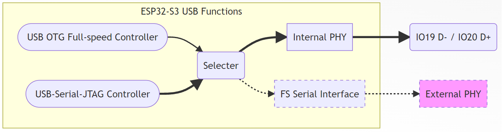
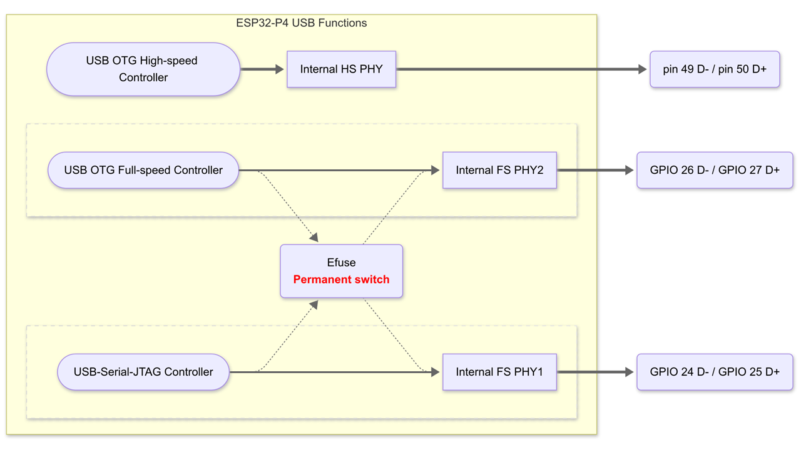
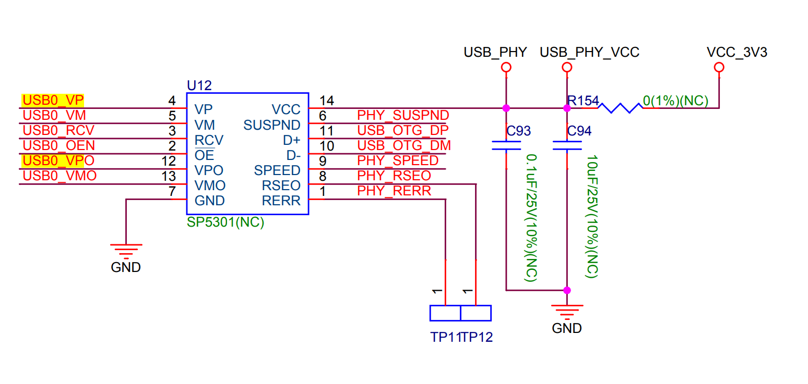

USB PHY/Transceiver 介绍
------------------------

:link_to_translation:`en:[English]`

USB PHY/Transceiver 的功能是将 USB 控制器的数字信号转换为 USB 总线信号电平，提供总线驱动能力，检测接收错误等。ESP32-S2/S3/P4 芯片已内置一个 USB Full-speed PHY，用户可直接使用芯片指定的 USB D+ D- 与外部 USB 系统通信。同时，ESP32-P4 还内置 USB High-Speed PHY。此外，ESP32-S2/S3 还保留了外部 PHY 的扩展接口，用户可在需要时连接外部 PHY。

使用内部 PHY
^^^^^^^^^^^^^^^^^^^^^^^^^^^^^^^^^^^^^

ESP32-S2/S3/C3 内部集成了 USB PHY，因此无需外接 PHY 芯片，可以直接与外部 USB 主机或设备通过 USB D+/D- 连接。ESP32-S3 的 USB-OTG 和 USB-Serial-JTAG 控制器共用一个内部 PHY，同一时间只有一个控制器可以使用该 PHY。

内部 USB-PHY 对应固定的 GPIO，如下表所示：

.. list-table::
   :header-rows: 1

   * -
     - D+
     - D-
   * - ESP32-S2
     - 20
     - 19
   * - ESP32-S3
     - 20
     - 19
   * - ESP32-C3
     - 19
     - 18
   * - ESP32-C6
     - 13
     - 12

对于 ESP32-P4 而言，内部集成了两个 USB Full-speed PHY 与一个 USB High-speed PHY。

内部 USB-PHY 对应的 GPIO，如下表所示：

.. list-table::
   :header-rows: 1

   * -
     - D+
     - D-
   * - ESP32-P4 FS_PHY1
     - 25
     - 24
   * - ESP32-P4 FS_PHY2
     - 27
     - 26
   * - ESP32-P4 HS_PHY
     - pin 50
     - pin 49

默认情况下，FS_PHY1 连接到 USB 串行/JTAG 控制器，FS_PHY2 连接到 OTG_FS，两个控制器可以同时工作。将 ``EFUSE_USB_PHY_SEL`` 置为 1 可交换两个全速 PHY 的连接。

.. _external_phy:

使用外部 PHY （ESP32-S2/S3）
^^^^^^^^^^^^^^^^^^^^^^^^^^^^^^^^^^^^^

在 ESP32-S3 上，增加一个外部 PHY 可让 USB-OTG 和 USB-Serial-JTAG 同时工作。ESP32-S2 只有 USB-OTG 控制器，该控制器也支持使用外部 PHY。

ESP32-S2/S3 支持 SP5301 或同等功能的 USB PHY。外部 PHY 的典型电路图如下：

..

   使用外部 USB PHY，将占用至少 6 个 GPIO

USB PHY 默认配置
^^^^^^^^^^^^^^^^^^^^^^^^^^^^

ESP32-S3 共用的内部 USB PHY 默认连接到 USB-Serial-JTAG，可通过内部 PHY 对应的引脚烧录固件或调试。

USB Host Driver 或 TinyUSB 协议栈在使用内部 PHY 初始化时，会将 PHY 切换到 USB-OTG。在默认 eFuse 配置下，如需通过同一组引脚使用 USB-Serial-JTAG 烧录固件，请手动进入 ROM 下载模式。

修改 USB PHY 默认配置
^^^^^^^^^^^^^^^^^^^^^^^^^^^^

以下两种方法适用于 ESP32-S3 共用的内部 USB PHY。

方法 1：通过配置寄存器，将 USB-PHY 连接切换为 USB-OTG。

* 配置为使用内部 PHY 时，USB Host Driver 或 TinyUSB 协议栈会设置 USB PHY 寄存器，将内部 PHY 连接到 USB-OTG。详情请参考 `USB PHY 配置 API <https://github.com/espressif/esp-idf/blob/master/components/esp_hw_support/include/esp_private/usb_phy.h>`_\ 。

方法 2：将 eFuse 的 ``USB_PHY_SEL`` 位烧写为 1，使内部 USB PHY 默认连接到 USB-OTG。

* 仅在需要通过内部 PHY 在 ROM 下载模式下使用 USB-OTG 功能（例如 USB DFU）时，才需烧写此 eFuse 位。
* 烧写此 eFuse 位后无法恢复。在 ROM 下载模式下，内部 PHY 对应的引脚将分配给 USB-OTG，USB-Serial-JTAG 将无法通过这些引脚使用。
* 受影响的 ESP32-S3 产品的 ``EFUSE_DIS_USB_OTG_DOWNLOAD_MODE`` （BLK0 B19[7]）已烧写为 1。若再烧写 ``USB_PHY_SEL``，将无法通过内部 PHY 对应的引脚使用 USB-Serial-JTAG 或 USB-OTG 下载功能。受影响产品的日期代码及生产工单见 `ESP32-S3 芯片勘误 USBOTG-4289 <https://docs.espressif.com/projects/esp-chip-errata/zh_CN/latest/esp32s3/03-errata-description/esp32s3/usb-otg-download-func-bug.html>`_\ 。
