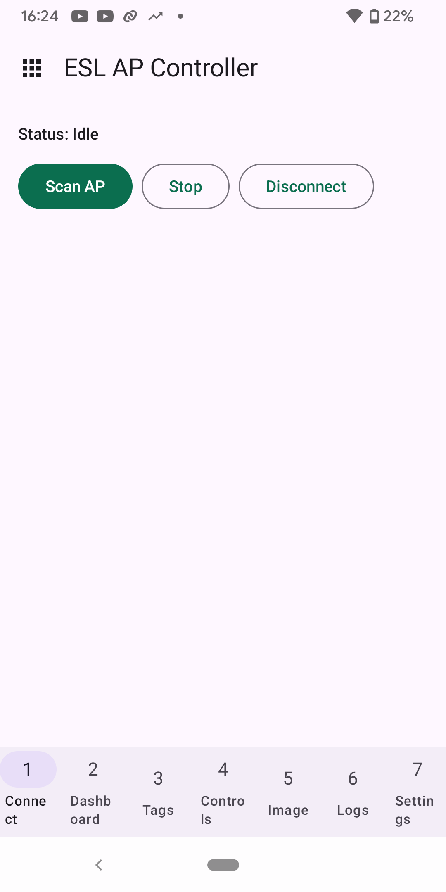
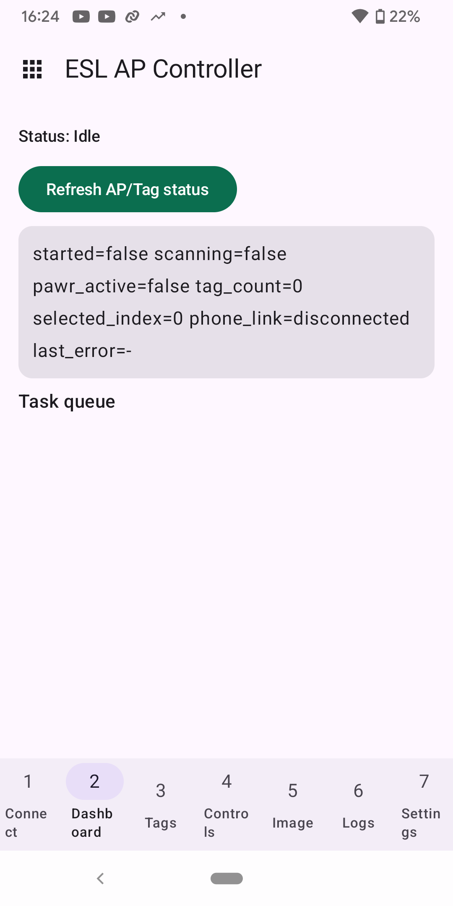
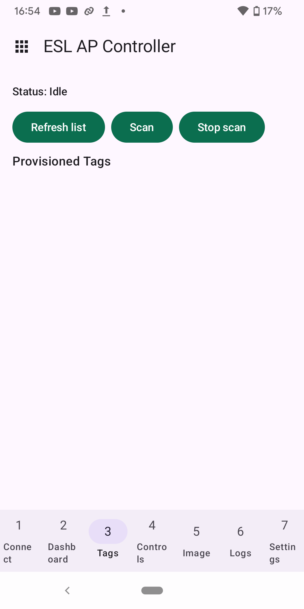
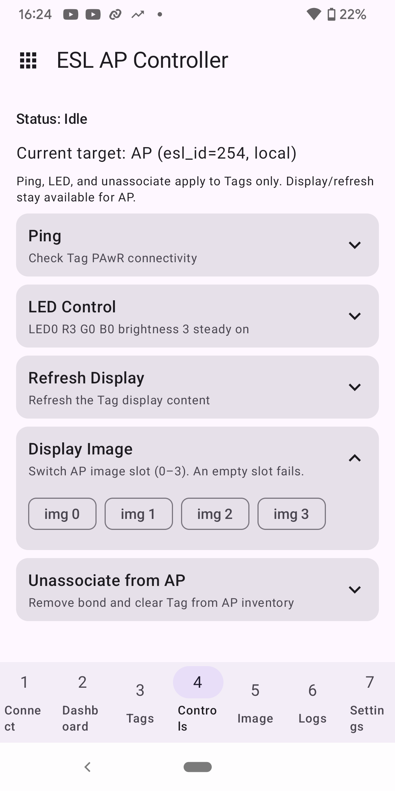
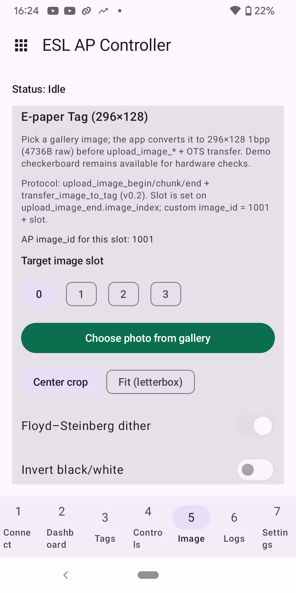

# BLE ESL profile examples

**English** | [中文](README_CN.md)

| Supported Targets | ESP32-H4 | ESP32-C6 | ESP32-S31 |
| --- | --- | --- | --- |

The two projects use iot-solution `esp_ble_eslp_*` and `ble_conn_mgr`. The phone connects to the AP; the AP manages the Tag.

| Project | Role |
| --- | --- |
| [`ble_esl_ap`](#access-point-ble_esl_ap) | Access Point with an NUS JSONL gateway for the ESP BLE App |
| [`ble_esl_tag`](#tag-ble_esl_tag) | Tag with SSD1680 e-paper on ESP32-C6/H4 |

## Access Point (`ble_esl_ap`)

This example sits on iot-solution `esp_ble_eslp_*` + `ble_conn_mgr` (not ESP-IDF `ble_esl_*`). Pair with [`ble_esl_tag`](#tag-ble_esl_tag).

### Requirements

- ESP-IDF **v6.1 or newer**
- PAwR-capable chip: **ESP32-H4**, **ESP32-C6**, or **ESP32-S31** (H4/S31 are preview: `idf.py --preview`)
- One Tag board running `ble_esl_tag` (SSD1680 e-paper on H4/C6)
- [ESP BLE App](https://github.com/EspressifApps/esp-ble-app) on an Android 12 or newer phone; install [app-debug.apk](https://github.com/EspressifApps/esp-ble-app/releases/download/v0.0.1/app-debug.apk) from the [v0.0.1 release](https://github.com/EspressifApps/esp-ble-app/releases/tag/v0.0.1)

### How to use

```bash
cd examples/bluetooth/ble_profiles/ble_esl/ble_esl_ap
idf.py set-target esp32c6    # or: idf.py --preview set-target esp32h4
idf.py erase-flash
idf.py build flash monitor
```

First bring-up: erase flash on AP and Tag so old NVS/bonds do not leak.

#### Configure

The default configuration (`sdkconfig.defaults` and Kconfig defaults) selects:

| Option | Value |
|--------|--------|
| AP operation mode | AP + phone app (`ESL_AP_MODE_WITH_APP`) |
| PAwR subevents | 4 |
| Ext-adv instances | 2 (PAwR instance 0, NUS instance 1) |
| NimBLE dynamic GATT | on (`CONFIG_BT_NIMBLE_DYNAMIC_SERVICE`; required so NUS can be registered after the host starts) |
| Max BLE connections | 3 (phone + Tag) |

### Expected App flow

Grant the app Bluetooth permissions and open **ESL → Connect → Scan AP**. The phone connects to the AP, which manages the Tag.

1. Phone connects to **ESP-ESL-AP** (NUS)
2. `provision_tag` → Tag associates and PAST-syncs
3. `upload_image_*` (4736-byte 1bpp SSD1680 frame) → `transfer_image_to_tag`
4. `display_image` / `refresh_display`

JSONL image upload over NUS is a demo transport (`max_chunk:192`).

### App screenshots

Select **ESL** from the app launcher, then use **Connect** to scan for `ESP-ESL-AP`. **Dashboard** shows AP/Tag status; **Tags** scans for Tags and lists provisioned ones; **Controls** acts on the selected target; **Image** selects a slot and prepares a photo for upload and transfer to a Tag. These screenshots show the UI before a BLE connection, not a completed transfer.

| App launcher | Connect: scan for AP | Dashboard: AP/Tag status |
| --- | --- | --- |
|  |  |  |

| Tags: scan/select a Tag | Controls: selected target | Image: slot and photo options |
| --- | --- | --- |
|  |  |  |

### Testing

There is no host-side unit-test target for this example yet. Validate on hardware with a PAwR-capable AP, a `ble_esl_tag` board, and the ESP BLE App (provision → image upload/transfer → display). Cover recovery after AP reboot and repeated `transfer_image_to_tag` while the Tag is synchronized.

## Tag (`ble_esl_tag`)

On **ESP32-C6** and **ESP32-H4**, the default build uses SSD1680 e-paper, LED backend **none**, and persistent association NVS. ESP32-S31 keeps the mock display backend (no e-paper pin preset). Pair with [`ble_esl_ap`](#access-point-ble_esl_ap) and use the [ESP BLE App](https://github.com/EspressifApps/esp-ble-app) to debug the Tag through the AP. Install [app-debug.apk](https://github.com/EspressifApps/esp-ble-app/releases/download/v0.0.1/app-debug.apk) from the [v0.0.1 release](https://github.com/EspressifApps/esp-ble-app/releases/tag/v0.0.1), then open **ESL → Connect → Scan AP**.

Stack: iot-solution `esp_ble_eslp_*` + `ble_conn_mgr`.

The phone controls this Tag through the AP; it does not connect to the Tag directly. Select **ESL** on the app launcher, connect to `ESP-ESL-AP`, then use the AP Controller's **Image** screen to prepare an image for the Tag.

See the [AP screenshots](#app-screenshots) for the connection, control, and Image screens.

### Requirements

- ESP-IDF **v6.1 or newer**
- **ESP32-H4** or **ESP32-C6** for SSD1680 wiring presets (S31 builds, but has no e-paper pin defaults)
- External SSD1680 panel (128×296, 4736-byte 1bpp frame)

### How to use

```bash
cd examples/bluetooth/ble_profiles/ble_esl/ble_esl_tag
idf.py set-target esp32c6    # or: idf.py --preview set-target esp32h4
idf.py erase-flash
idf.py build flash monitor
```

`sdkconfig.defaults` selects the `ESP_ESL_TAG` name, 4 image slots, `MAX_IMAGE_SIZE=4736`, 4MB flash, NimBLE bond persistence, and `partitions.csv` (`images`, data subtype `0x40`, 64 KB at `0x210000`). `sdkconfig.defaults.esp32c6` and `sdkconfig.defaults.esp32h4` select the SSD1680 backend and LED none. ESP32-S31 stays on the mock display; it still uses the same slots, object size, and `images` partition, so image-store init does not abort. A partition-table change needs `idf.py erase-flash` before the next flash. NimBLE connection reattempt is disabled (`CONFIG_BT_NIMBLE_ENABLE_CONN_REATTEMPT=n`); `ble_conn_mgr` restarts advertising after a disconnect.

### E-paper pins (Kconfig defaults)

| Item | ESP32-H4 | ESP32-C6 |
|------|----------|----------|
| Power GPIO | 37 (active-high) | 8 (active-low) |
| DC / RST / CS / BUSY | 1 / 16 / 0 / 17 | 20 / 19 / 21 / 22 |
| MOSI / SCLK | 38 / 39 | 18 / 15 |
| Frame | 128 × 296 / 8 = **4736** bytes, linear 1bpp | same |

Display Information reports **296×128** black/white to match the product App.
