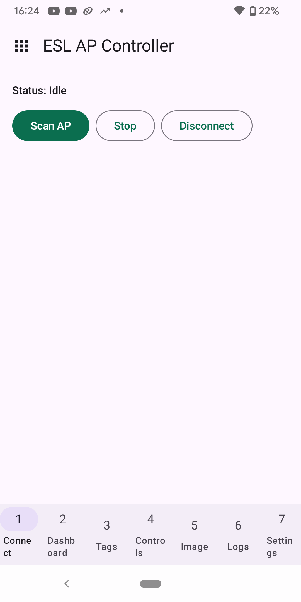
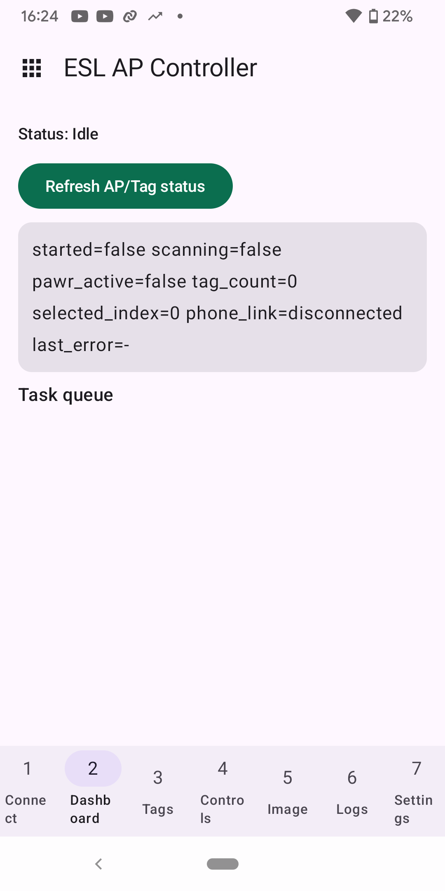
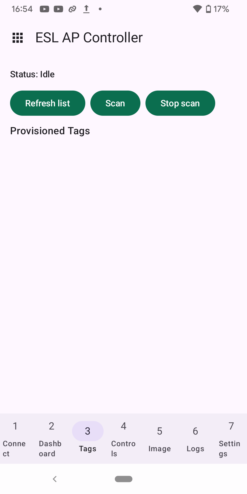
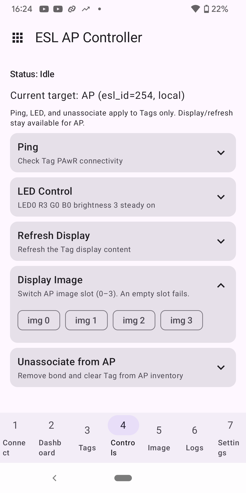
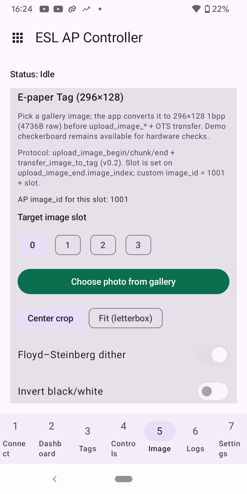

# BLE ESL Profile 示例

[English](README.md) | **中文**

| 支持的芯片 | ESP32-H4 | ESP32-C6 | ESP32-S31 |
| --- | --- | --- | --- |

两个工程使用 iot-solution 的 `esp_ble_eslp_*` 和 `ble_conn_mgr`。手机连接 AP，再由 AP 管理 Tag。

| 工程 | 作用 |
| --- | --- |
| [`ble_esl_ap`](#接入点ble_esl_ap) | 接入点，通过 NUS JSONL 与 ESP BLE App 通信 |
| [`ble_esl_tag`](#tagble_esl_tag) | Tag，在 ESP32-C6/H4 上使用 SSD1680 电子纸 |

## 接入点（`ble_esl_ap`）

本示例基于 iot-solution 的 `esp_ble_eslp_*` 与 `ble_conn_mgr`（不是 ESP-IDF `ble_esl_*`）。请与 `ble_esl_tag` 配对。

### 环境要求

- ESP-IDF **v6.1 及以上**
- 支持 PAwR 的芯片：**ESP32-H4**、**ESP32-C6** 或 **ESP32-S31**（H4/S31 为 preview：`idf.py --preview`）
- 一块运行 `ble_esl_tag` 的 Tag（H4/C6 接 SSD1680 电子纸）
- Android 12 及以上手机安装 [ESP BLE App](https://github.com/EspressifApps/esp-ble-app) 的 [app-debug.apk](https://github.com/EspressifApps/esp-ble-app/releases/download/v0.0.1/app-debug.apk)；安装包来自 [v0.0.1 发布页](https://github.com/EspressifApps/esp-ble-app/releases/tag/v0.0.1)

### 使用方法

```bash
cd examples/bluetooth/ble_profiles/ble_esl/ble_esl_ap
idf.py set-target esp32c6    # 或: idf.py --preview set-target esp32h4
idf.py erase-flash
idf.py build flash monitor
```

首次联调请对 AP 和 Tag 都执行 `erase-flash`，避免旧 NVS/绑定残留。

默认配置（`sdkconfig.defaults` 和 Kconfig 默认值）包括：

| 配置项 | 值 |
| --- | --- |
| AP 模式 | AP + 手机 App（`ESL_AP_MODE_WITH_APP`） |
| PAwR 子事件数 | 4 |
| 扩展广播实例数 | 2（PAwR 实例 0，NUS 实例 1） |
| NimBLE 动态 GATT | 开启（`CONFIG_BT_NIMBLE_DYNAMIC_SERVICE`） |
| BLE 最大连接数 | 3（手机 + Tag） |

手机网关在 BLE host 启动之后注册 NUS，必须使用动态 GATT；关闭该选项时编译失败。

### App 预期流程

授予 App 蓝牙权限后，打开 **ESL → Connect → Scan AP**。手机连接 AP，再由 AP 管理 Tag。

1. 手机连接 **ESP-ESL-AP**（NUS）
2. `provision_tag` → Tag 入网并 PAST 同步
3. `upload_image_*`（4736 字节 1bpp SSD1680 帧）→ `transfer_image_to_tag`
4. `display_image` / `refresh_display`

通过 NUS 上传 JSONL 图像只是演示用的传输方式（`max_chunk:192`）。

### App 界面截图

在 App 主界面选择 **ESL**，通过 **Connect** 搜索并连接 `ESP-ESL-AP`。**Dashboard** 查看 AP/Tag 状态，**Tags** 扫描 Tag 并列出已配置的 Tag，**Controls** 对选定目标发送命令，**Image** 选择图像槽并准备照片上传及传输到 Tag。截图展示的是尚未连接 BLE 时的界面，并不表示传输已完成。

| App 主界面 | Connect：扫描 AP | Dashboard：AP/Tag 状态 |
| --- | --- | --- |
|  |  |  |

| Tags：扫描/选择 Tag | Controls：控制界面 | Image：图像槽与照片选项 |
| --- | --- | --- |
|  |  |  |

### 测试说明

本示例尚未提供无硬件的 Host tests。请在支持 PAwR 的 AP、`ble_esl_tag` 与 ESP BLE App 上做硬件验证（配网 → 传图 → 显示），并覆盖 AP 重启后的 recovery 以及 Tag 已同步时的多次 `transfer_image_to_tag`。

## Tag（`ble_esl_tag`）

**ESP32-C6** 与 **ESP32-H4** 默认使用 SSD1680 电子纸、关闭 LED 后端，并将关联信息写入 NVS。ESP32-S31 保持 mock 显示后端（没有电子纸默认引脚）。请与 `ble_esl_ap` 配对，并通过 [ESP BLE App](https://github.com/EspressifApps/esp-ble-app) 连接 AP 来调试 Tag。从 [v0.0.1 发布页](https://github.com/EspressifApps/esp-ble-app/releases/tag/v0.0.1)安装 [app-debug.apk](https://github.com/EspressifApps/esp-ble-app/releases/download/v0.0.1/app-debug.apk)，再打开 **ESL → Connect → Scan AP**。

协议栈：iot-solution `esp_ble_eslp_*` + `ble_conn_mgr`。

手机通过 AP 控制此 Tag，不会直接连接 Tag。在 App 主界面选择 **ESL**，连接 `ESP-ESL-AP`，再通过 AP Controller 的 **Image** 页面准备要传输到 Tag 的图像。

连接、控制和图像页面见[上文的 AP 界面截图](#app-界面截图)。

### 环境要求

- ESP-IDF **v6.1 及以上**
- **ESP32-H4** 或 **ESP32-C6**（SSD1680 默认引脚）；S31 可编译但无电子纸默认脚
- 外接 SSD1680（128×296，4736 字节 1bpp 帧）

### 使用方法

```bash
cd examples/bluetooth/ble_profiles/ble_esl/ble_esl_tag
idf.py set-target esp32c6    # 或: idf.py --preview set-target esp32h4
idf.py erase-flash
idf.py build flash monitor
```

`sdkconfig.defaults` 选择广播名 `ESP_ESL_TAG`、4 个图像槽、`MAX_IMAGE_SIZE=4736`、4MB Flash、NimBLE 绑定持久化，以及 `partitions.csv`（`images`，data 子类型 `0x40`，`0x210000` 处 64 KB）。`sdkconfig.defaults.esp32c6` 与 `sdkconfig.defaults.esp32h4` 选择 SSD1680 后端并关闭 LED。ESP32-S31 仍使用 mock 显示，但图像槽、对象大小和 `images` 分区相同，因此图像存储初始化不会中止。分区表变更后需要先执行 `idf.py erase-flash` 再烧录。NimBLE 连接重试已关闭（`CONFIG_BT_NIMBLE_ENABLE_CONN_REATTEMPT=n`）；断开连接后的重新广播由 `ble_conn_mgr` 负责。

### 电子纸默认引脚

| 项目 | ESP32-H4 | ESP32-C6 |
|------|----------|----------|
| 电源 GPIO | 37（高有效） | 8（低有效） |
| DC / RST / CS / BUSY | 1 / 16 / 0 / 17 | 20 / 19 / 21 / 22 |
| MOSI / SCLK | 38 / 39 | 18 / 15 |
| 帧大小 | 128 × 296 / 8 = **4736** 字节，线性 1bpp | 同左 |

Display Information 向 App 报告 **296×128** 黑白屏信息。
