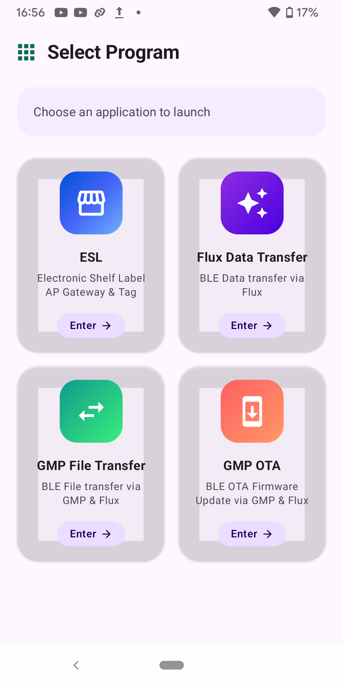
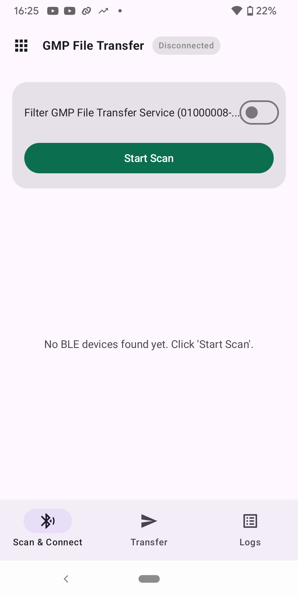
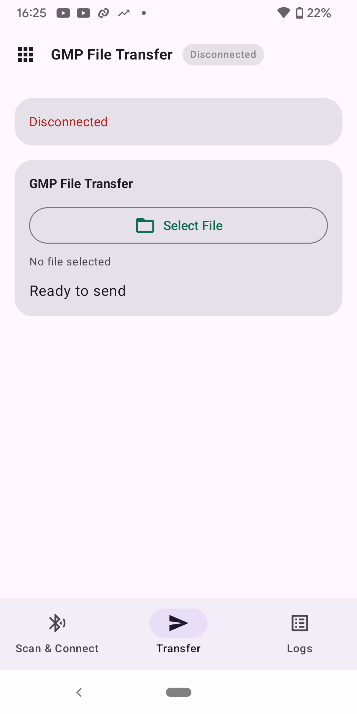

# ESP File Transfer Example

**English** | [中文](README_CN.md)

This example contains two independently buildable ESP32-H4 projects:

- `sender_demo` actively establishes the link and sends files on Console
  commands.
- `receiver_demo` waits for the link and receives files passively.

The names describe the default demonstration direction only. Both projects
initialize the same bidirectional File Transfer profile in `esp_gmp`
(`CONFIG_ESP_GMP_PROFILE_FILE_TRANSFER`) and expose the same Console commands.

The example integration layer uses BLE GATT with
`esp_gmp -> GMP Flux adapter -> esp_flux`. The File Transfer profile itself
remains independent of BLE and Flux.

BLE connection management (scanning, advertising, GATT service registration,
service discovery and reconnection) is handled by the `ble_conn_mgr` component.
The sender runs as central (`CONFIG_BLE_CONN_MGR_ROLE_CENTRAL`) and connects to
the receiver, which runs as peripheral
(`CONFIG_BLE_CONN_MGR_ROLE_PERIPHERAL`) and publishes the file transfer service
UUID in its connectable advertising data. The sender connects only when that
UUID is present. Either side re-establishes the link automatically
after a reset or a link loss.

**Scope:** demos and the profile worker are validated for a single active BLE
link. `sessions[]` is preparatory plumbing only — concurrent multi-link file
transfer is not supported in this release.

## Build

Activate your local ESP-IDF environment, then run these commands from the repository root:

```bash
cd examples/esp_file_transfer/sender_demo
idf.py --preview set-target esp32h4
idf.py build

cd ../receiver_demo
idf.py --preview set-target esp32h4
idf.py build
```

Flash each project to one board with `idf.py flash monitor`.

Both projects mount the `storage` FATFS partition at `/fatfs`. The generated
partition image contains `/fatfs/send/demo.txt`; mount failures are reported
without automatic formatting.
The example limits each file to 2 MiB, leaving filesystem overhead in the
approximately 2.375 MiB FATFS partition.
To exercise cancellation or link loss, create a larger file before building
the sender. Run the following commands from the repository root:

```bash
cd examples/esp_file_transfer
dd if=/dev/urandom of=sender_demo/storage/send/large.bin bs=1024 count=1024
```

If you already built the sender, rebuild and flash it after adding the file so the new FATFS image reaches the board.

For the two-board workflow below, start both boards. The sender scans for and
connects to the receiver. Begin verification only after both boards report:

```text
File transfer link ready
```

Received files are stored under `/fatfs/recv`. Existing names are preserved;
new transfers receive `_1`, `_2`, and subsequent suffixes.

### Check configuration and initial state

Run on both Consoles:

```text
ft config
```

Expected output includes:

```text
Config: recv_dir=/fatfs/recv, max_file_size=2097152, block_size=auto
Link: ready
```

Then run:

```text
ft status
```

Expected:

```text
Status: idle
```

### Forward transfer

Run on the sender Console:

```text
ft send /fatfs/send/demo.txt
```

Expected sender event order:

```text
Transfer started
Transfer metadata sent
Transfer peer accepted
Progress
Transfer complete
```

Expected receiver event order:

```text
Transfer metadata received
Transfer started
Progress
Transfer verifying
Transfer complete
```

The sender reports `Transfer complete` only after the receiver has written the
file, verified SHA256, committed the target file, and returned a successful
final confirmation.

After completion, run on both Consoles:

```text
ft status
```

Expected on both:

```text
Status: idle
```

### Existing-name handling

Run the same command again on the sender:

```text
ft send /fatfs/send/demo.txt
```

If `/fatfs/recv/demo.txt` already exists, the completion log should include:

```text
saved=demo_1.txt
```

Subsequent transfers use `demo_2.txt`, `demo_3.txt`, and so on without
overwriting existing files.

### Reverse transfer

Run on the receiver Console:

```text
ft send /fatfs/send/demo.txt
```

The receiver now acts as the sender, while the sender board passively stores
the file under `/fatfs/recv`. The event order is the same with the roles
reversed. There is no `ft receive` command.

### Cancel a transfer

Use a file large enough to keep the transfer active and run:

```text
ft send /fatfs/send/large.bin
```

Immediately run:

```text
ft cancel
```

Expected on the initiating board:

```text
Cancel requested
Transfer cancelled
```

The peer should terminate the transfer and remove the corresponding
`ft_tmp/*.part`. After cleanup, `ft status` should report `Status: idle` on
both boards.

### Link-loss recovery

Reset or disconnect either board while transferring a large file. The current
transfer should fail without leaving a `.part` file. After the boards reconnect
and both report `File transfer link ready`, a new transfer should succeed.

Note that a full `idf.py flash` rewrites the example FATFS image and removes
files received at runtime. Use `idf.py app-flash` when updating only the
application while preserving `/fatfs`.

## Debug `receiver_demo` with an Android app

`receiver_demo` advertises as `ESP-File-Transfer` and receives files over BLE. You can also use the [ESP BLE App](https://github.com/EspressifApps/esp-ble-app) to debug it from an Android 12 or newer phone instead of using a `sender_demo` board. Install [app-debug.apk](https://github.com/EspressifApps/esp-ble-app/releases/download/v0.0.1/app-debug.apk) from the [v0.0.1 release](https://github.com/EspressifApps/esp-ble-app/releases/tag/v0.0.1), grant Bluetooth permissions, and start `receiver_demo`. In the app, open **GMP File Transfer → Scan & Connect**, connect to `ESP-File-Transfer`, then select a file in **Transfer** and tap **Send File**.

The launcher opens the file-transfer tool. **Scan & Connect** finds the receiver, and **Transfer** selects the file to send. The screenshots show the disconnected state; sending becomes available after connection.

| App launcher | Scan & Connect | Transfer: select a file |
| --- | --- | --- |
|  |  |  |
