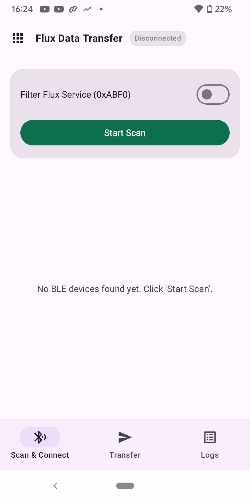
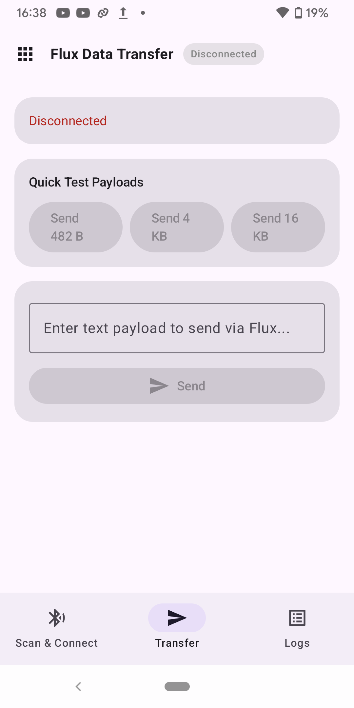

# BLE SPP 示例

[English](README.md) | **中文**

本示例结合 `ble_conn_mgr`（连接管理和 GATT 服务发现）与 `esp_flux` 的 `gatt_session`（可靠分片传输），实现类似 BLE 串口的应用。

## 示例组成

- `ble_spp_server`：BLE 外设，广播 SPP 服务并接受连接。
- `ble_spp_client`：BLE 中心设备，扫描 SPP Server 并主动连接。

两个工程都演示通过 `ble_conn_mgr` 管理可配置的连接（默认每块开发板一条链路），以及通过 `esp_flux` / `gatt_session` 完成自动分片、SACK、重组和可靠传输。Client 使用 `ble_conn_mgr` 发现 GATT 服务；Server 已知自身特征句柄。示例中的 FreeRTOS 定时器负责断线恢复：Server 每 2 秒重新尝试广播；Client 在有空余连接槽时每 5 秒停止并重新启动扫描。

连接建立且连接参数协商完成后，两端会在发送会话空闲时持续互发固定大小的测试数据。

## 硬件要求

- 支持 BLE NimBLE 的 ESP32 芯片（已在 ESP32-H2、ESP32-C2 上测试）。
- 用于烧录和供电的 USB 线。

## 构建与烧录

分别构建 Server 和 Client；在仓库根目录执行：

```bash
cd examples/esp_flux/ble_spp_server  # Client 改为 ble_spp_client
idf.py set-target esp32h2
idf.py build
idf.py flash monitor
```

也可以分别执行 `idf.py flash` 和 `idf.py monitor`。

## 使用方法

### 运行 Server

1. 构建并烧录 `ble_spp_server`，设备以 `ble-spp-server` 名称广播。
2. 等待 Client 连接。连接参数就绪后，Server 记录收到的数据长度，并在发送会话空闲时持续发送 `SPP_TEST_TRANSFER_SIZE` 大小的测试数据（约 4.3 KB）。

也可以使用 Android 12 及以上手机上的 [ESP BLE App](https://github.com/EspressifApps/esp-ble-app) 调试 Server。从 [v0.0.1 发布页](https://github.com/EspressifApps/esp-ble-app/releases/tag/v0.0.1)安装 [app-debug.apk](https://github.com/EspressifApps/esp-ble-app/releases/download/v0.0.1/app-debug.apk)，授予蓝牙权限，在 **Flux Data Transfer → Scan & Connect** 中连接 `ble-spp-server`，然后通过 **Transfer** 发送文本或示例数据，并在 **Logs** 查看消息。

主界面用于进入 Flux Data Transfer；**Scan & Connect** 用于扫描 Server，Flux 服务过滤器可以不启用；**Transfer** 提供预设数据长度和文本输入框。截图展示的是未连接状态，因此发送控件不可用。

| App 主界面 | Scan & Connect：扫描设备 | Transfer：示例数据或文本 |
| --- | --- | --- |
|  |  |  |

### 运行 Client

1. 构建并烧录 `ble_spp_client`。Client 会扫描 SPP Server，并在发现后自动连接。
2. 连接后，Client 执行 GATT 服务发现并启用 SPP 特征的通知。
3. 连接参数就绪后，Client 同样会在发送会话空闲时持续发送固定大小的测试数据。

### 多设备测试

两个工程默认均设置 `CONFIG_BLE_CONN_MGR_MAX_CONNECTIONS=1`。如需让一块开发板同时连接多个对端，请先提高该值并重新构建。

在一台或多台设备上烧录 Server，在一台或多台设备上烧录 Client。Client 会发现并连接可用的 Server，建立连接后设备间开始传输数据。

## 配置

### 传输大小

Client 和 Server 的 `main/main.c` 都使用以下编译期常量：

```c
#define SPP_TEST_TRANSFER_SIZE  (482 + 491 * 8) // 4411 bytes
```

修改该值后重新构建，即可测试不同数据大小。发送调用同时设置滑动窗口和 SACK 阈值：

```c
gatt_session_send(session, send_buffer, SPP_TEST_TRANSFER_SIZE, 0xFF, 80);
```

其中 `0xFF` 表示窗口不设上限，`80` 为 SACK 阈值百分比。

### 组件配置

运行 `idf.py menuconfig`，在 `Component config` → `BLE Connection Management` 中设置：

- `BLE_CONN_MGR_ROLE`：Server 使用 Peripheral，Client 使用 Central。
- `BLE_CONN_MGR_MAX_CONNECTIONS`：同时允许的 BLE 连接数。

`esp_flux` 没有 Kconfig 配置项。默认窗口大小、分片超时和重传等参数是 `components/esp_flux/include/esp_flux_transport.h` 中的编译期常量，参见 [esp_flux 组件文档](../../components/esp_flux/README.md#configuration)。

## 示例日志

Server：

```text
I (1234) spp server: Starting BLE Component Test Example
I (1235) spp server: GATT characteristic handle initialized: 0x0015
I (1236) spp server: Connected successfully to device XX:XX:XX:XX:XX:XX (conn_handle=1)
I (1237) spp server: GATT session created for conn_handle=1, val_handle=0x0015, mtu=23
W (2000) spp server: Session 1 stream 0 received data, Data Size: 4411 bytes (4.31 KB)
I (3000) spp server: Started send to conn_handle=1 (4411 bytes)
```

Client：

```text
I (1234) spp client: Starting BLE Component Test Example
I (1235) spp client: Connected successfully to device XX:XX:XX:XX:XX:XX (conn_handle=1)
I (1236) spp client: Service discovery completed for connection 1
I (1240) spp client: Started send to conn_handle=1 (4411 bytes)
I (1241) spp client: Session conn_handle: 1 progress: 25% (1102/4411 bytes)
I (1242) spp client: Session conn_handle: 1 progress: 50% (2205/4411 bytes)
...
I (1245) spp client: Session conn_handle 1 stream 0 send completed successfully (4411 bytes)
```

## 代码结构

两个工程都包含 `main/main.c`、`main/CMakeLists.txt`、工程 `CMakeLists.txt` 和 `sdkconfig.defaults`。

Server 中的主要函数：

- `esp_ble_conn_add_svc()` / `esp_ble_conn_start()`：注册 SPP 服务并开始广播。
- `app_ble_conn_event_handler()`：处理连接、断开和接收事件，创建 GATT 会话。
- `spp_reconnect_timer_cb()`：断开后重新开始广播。
- `gatt_data_received_cb()` / `gatt_session_complete_cb()`：处理接收数据和发送完成事件。

Client 中的主要函数：

- `spp_scan_cb()`：按 SPP UUID 过滤扫描结果并连接。
- `app_ble_conn_event_handler()`：处理连接、断开和服务发现，创建 GATT 会话。
- `spp_reconnect_timer_cb()`：每 5 秒在连接数低于 `BLE_CONN_MGR_MAX_CONNECTIONS` 时调用 `esp_ble_conn_scan_stop()` 和 `esp_ble_conn_scan_start()`；不保存对端地址，也不限制重试次数。
- `gatt_data_received_cb()` / `gatt_session_complete_cb()`：处理接收数据和发送完成事件。

## 故障排查

- 无法连接：确认设备已上电且距离合适；检查 Server 广播、Client 扫描以及连接间隔、延迟和超时设置。
- 传输失败：确认 MTU 协商完成；检查窗口大小、可用堆内存和重传超时。
- 内存不足：减小 `main/main.c` 中的 `SPP_TEST_TRANSFER_SIZE`，或通过 `menuconfig` 降低 `BLE_CONN_MGR_MAX_CONNECTIONS`，并查看日志中的空闲堆大小。

## 性能建议

可尝试将窗口大小设为 4–6、协商更大的 MTU（最高 517 字节）、按延迟需求调整连接间隔，并根据 MTU 选择数据分块大小。

## API 参考

- [esp_ble_conn_mgr.h](../../components/bluetooth/ble_conn_mgr/include/esp_ble_conn_mgr.h)：BLE 连接管理。
- [esp_flux_transport.h](../../components/esp_flux/include/esp_flux_transport.h)：与传输媒介无关的协议引擎。
- [flux_gatt_session.h](../../components/esp_flux/include/flux_gatt_session.h)：BLE GATT 可靠传输会话。

相关组件：[BLE Connection Management](../../components/bluetooth/ble_conn_mgr/README.md)、[ESP Flux](../../components/esp_flux/README.md)。

本示例采用 Apache License 2.0；详情见仓库中的 LICENSE 文件。
