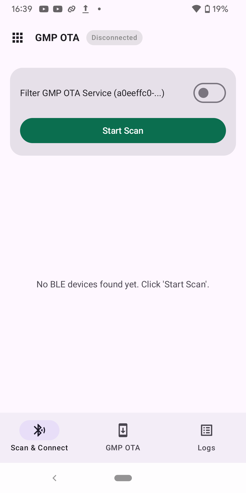
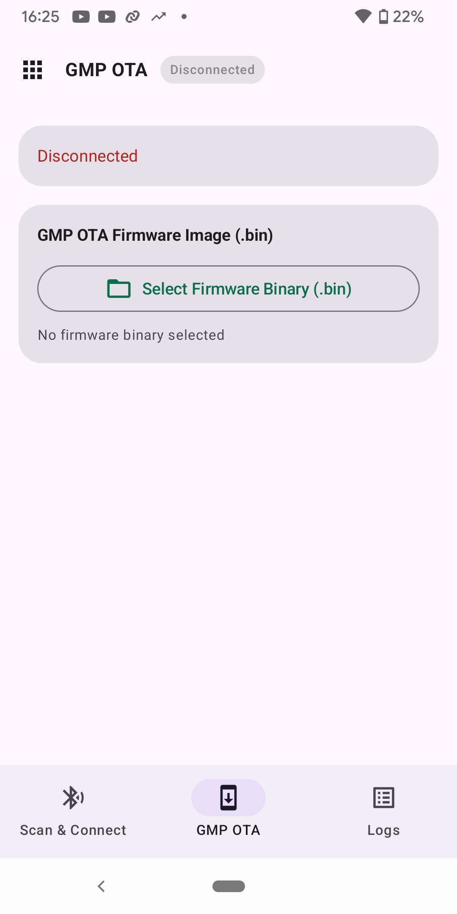

# GMP OTA BLE Example

**English** | [中文](README_CN.md)

End-to-end OTA demo over GMP-on-Flux:

- **Server (device)**: writes received firmware **directly to an OTA partition** and reboots (no SPIFFS inside the OTA handler)
- **Client (host)**: **manages the upgrade image in SPIFFS**, then connects and uploads it to the server

BLE connection management (scanning, advertising, GATT service registration,
service discovery and reconnection) is handled by the `ble_conn_mgr` component.
The client runs as central (`CONFIG_BLE_CONN_MGR_ROLE_CENTRAL`) and connects to
the server, which runs as peripheral (`CONFIG_BLE_CONN_MGR_ROLE_PERIPHERAL`) and
publishes the GMP service UUID in its connectable advertisement. The client reconnects
automatically after the server reboots into the new image or after a link loss.

## Layout

```text
examples/esp_gmp/gmp_ota/
├── common_components/gmp_ota_common/
├── ble_gmp_ota_server/     # peripheral, dual OTA partitions
└── ble_gmp_ota_client/     # central, SPIFFS holds ota_image.bin
```

## Hardware

- **Server**: 4 MB Flash (dual OTA slots, `0x1A0000` bytes each)
- **Client**: 4 MB Flash (factory + SPIFFS `storage` ~2 MB for firmware)

The image to upload must not exceed the server OTA slot size. The client SPIFFS can hold a larger file, but the server rejects oversized images at `START`.

## Build the server

```bash
cd examples/esp_gmp/gmp_ota/ble_gmp_ota_server
idf.py set-target esp32
idf.py build flash monitor
```

The server advertises as `ESP-GMP-OTA` and receives firmware over BLE. Keep the uploaded image within the OTA slot size described above.

You can use the [ESP BLE App](https://github.com/EspressifApps/esp-ble-app) to debug `ble_gmp_ota_server` from an Android 12 or newer phone instead of using the example client board. Install [app-debug.apk](https://github.com/EspressifApps/esp-ble-app/releases/download/v0.0.1/app-debug.apk) from the [v0.0.1 release](https://github.com/EspressifApps/esp-ble-app/releases/tag/v0.0.1), grant Bluetooth permissions, and start the server. Open **GMP OTA → Scan & Connect**, connect to `ESP-GMP-OTA`, then select a firmware `.bin` file and tap **Start GMP OTA Update**.

Select **GMP OTA** on the launcher. **Scan & Connect** finds the server, and the **GMP OTA** page selects the firmware binary to upload. The screenshots show the disconnected state, not an OTA in progress.

| App launcher | Scan & Connect | GMP OTA: select firmware |
| --- | --- | --- |
|  |  |  |

## Build the client

After building the server, run the following commands from its project directory:

```bash
cp build/ble_gmp_ota_server.bin ../ble_gmp_ota_client/spiffs/ota_image.bin

cd ../ble_gmp_ota_client
idf.py set-target esp32
idf.py build flash monitor
```

The client reads `/spiffs/ota_image.bin`, scans for `ESP-GMP-OTA`, then uploads automatically.

If `ble_gmp_ota_client/spiffs/ota_image.bin` is missing, the client still builds and flashes; at runtime it logs that the image is missing and skips the OTA upload.

## Security boundary

This example only demonstrates the GMP-over-Flux OTA data path. It does not verify firmware provenance, does not enable BLE access control, and does not replace signed app images or secure boot. Use it only in controlled lab setups. Production products must add link authentication, application authorization, and firmware trust checks.

The client example does not auto-format a failed SPIFFS mount (`format_if_mount_failed=false`); mount failure aborts with an error. To refresh `ota_image.bin`, copy the firmware to `ble_gmp_ota_client/spiffs/ota_image.bin`, then run `idf.py build flash` in `ble_gmp_ota_client` so `storage.bin` is regenerated and written to the `storage` SPIFFS partition at `0x110000`. Check that `ble_gmp_ota_client/build/flash_args` lists `0x110000 storage.bin`. At runtime the client reads `/spiffs/ota_image.bin`.

## Component API

Device-side OTA handler: `esp_gmp_ota_init()` (see `components/esp_gmp/profiles/ota/`).

Protocol: [`SPEC.md`](../../../components/esp_gmp/SPEC.md).

## Suggested tests

Basic protocol and OTA payload parsing are covered by `components/esp_gmp/test`. For the BLE OTA examples, cover in HIL or manual integration tests: `OS_CAP_QUERY`, small-image upload, disconnect abort, FINISH timeout boundaries, and the runtime skip path when `ota_image.bin` is missing.
