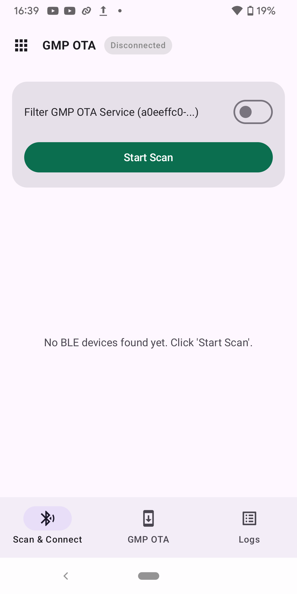
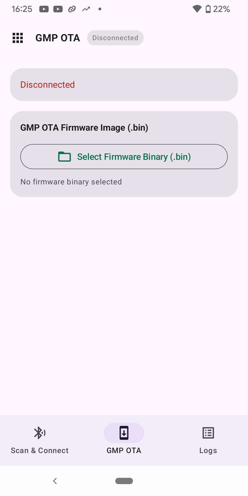

# GMP OTA BLE 示例

[English](README.md) | **中文**

GMP over Flux 的完整 OTA 演示：

- **Server（设备）**：收到固件后 **直写 OTA 分区** 并重启（框架内无 SPIFFS）
- **Client（主机）**：用 **SPIFFS 管理待升级固件**，连接后推送给 Server

BLE 连接管理（扫描、广播、GATT 服务注册、服务发现与重连）由 `ble_conn_mgr`
组件负责：client 以 central 角色运行（`CONFIG_BLE_CONN_MGR_ROLE_CENTRAL`），
server 以 peripheral 角色运行（`CONFIG_BLE_CONN_MGR_ROLE_PERIPHERAL`）并在扫描
可连接广播包中携带 GMP 服务 UUID。Server 升级重启或链路断开后，client 会自动重新建链。

## 目录

```text
examples/esp_gmp/gmp_ota/
├── common_components/gmp_ota_common/
├── ble_gmp_ota_server/     # 外设，双 OTA 分区
└── ble_gmp_ota_client/     # 中心，SPIFFS 存 ota_image.bin
```

## 硬件

- **Server**：4 MB Flash（双 OTA 槽，每个 OTA 槽 `0x1A0000` 字节）
- **Client**：4 MB Flash（factory + SPIFFS `storage` 约 2 MB 固件区）

待上传镜像必须不大于 Server OTA 槽大小。Client SPIFFS 可以容纳更大的文件，但 Server 会在 `START` 阶段拒绝超过 OTA 槽容量的镜像。

## 构建 Server

```bash
cd examples/esp_gmp/gmp_ota/ble_gmp_ota_server
idf.py set-target esp32
idf.py build flash monitor
```

Server 以 `ESP-GMP-OTA` 广播并通过 BLE 接收固件。待上传镜像不得超过上文说明的 OTA 槽容量。

也可以使用 [ESP BLE App](https://github.com/EspressifApps/esp-ble-app) 在 Android 12 及以上手机上代替示例 Client 开发板调试 `ble_gmp_ota_server`。从 [v0.0.1 发布页](https://github.com/EspressifApps/esp-ble-app/releases/tag/v0.0.1)安装 [app-debug.apk](https://github.com/EspressifApps/esp-ble-app/releases/download/v0.0.1/app-debug.apk)，授予蓝牙权限并启动 Server。在 App 中打开 **GMP OTA → Scan & Connect**，连接 `ESP-GMP-OTA`，再选择固件 `.bin` 文件并点击 **Start GMP OTA Update**。

在主界面选择 **GMP OTA**；**Scan & Connect** 用于查找 Server，**GMP OTA** 页面用于选择待上传的固件文件。截图展示的是未连接状态，并非正在升级。

| App 主界面 | Scan & Connect：扫描设备 | GMP OTA：选择固件 |
| --- | --- | --- |
|  |  |  |

## 构建 Client

构建 Server 后，在 Server 工程目录执行：

```bash
cp build/ble_gmp_ota_server.bin ../ble_gmp_ota_client/spiffs/ota_image.bin

cd ../ble_gmp_ota_client
idf.py set-target esp32
idf.py build flash monitor
```

Client 从 `/spiffs/ota_image.bin` 读取固件，扫描 `ESP-GMP-OTA` 后自动上传。

如果未放置 `ble_gmp_ota_client/spiffs/ota_image.bin`，Client 仍可构建和烧录；运行时会提示缺少固件并跳过 OTA 上传。

## 安全边界

本示例只演示 GMP-over-Flux OTA 数据通路，不验证固件来源，不启用 BLE 访问控制，也不替代 signed app 或 secure boot。请仅在受控实验环境中使用；生产产品需要自行增加链路鉴权、业务授权和固件可信校验。

Client 示例默认挂载 SPIFFS 时不会自动格式化失败分区（`format_if_mount_failed=false`）；挂载失败会报错退出。如需更新 `ota_image.bin`，将固件复制到 `ble_gmp_ota_client/spiffs/ota_image.bin`，然后在 `ble_gmp_ota_client` 目录执行 `idf.py build flash`，重新生成 `storage.bin` 并将其写入 `0x110000` 处的 `storage` SPIFFS 分区。检查 `ble_gmp_ota_client/build/flash_args` 是否包含 `0x110000 storage.bin`。运行时 Client 从 `/spiffs/ota_image.bin` 读取固件。

## 组件 API

设备侧 OTA 处理器：`esp_gmp_ota_init()`（见 `components/esp_gmp/profiles/ota/`）。

协议：[`SPEC.md`](../../../components/esp_gmp/SPEC.md)。

## 测试建议

基础协议和 OTA payload 解析由 `components/esp_gmp/test` 覆盖。BLE OTA 示例建议在 HIL 或手工集成测试中覆盖：`OS_CAP_QUERY`、小镜像上传、断链取消、FINISH 超时边界，以及缺少 `ota_image.bin` 时运行时跳过 OTA 的日志路径。
