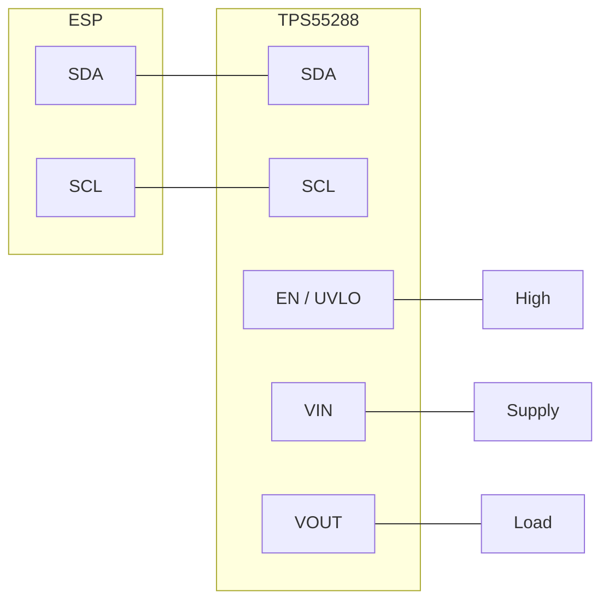

# TPS55288 Example

Drive a TI TPS55288 buck-boost converter over I2C. The example forces the output off, sets a 500 mA limit, enables 2000 mV, then switches to 3000 mV and turns the output off.

The chip driver is `components/power/tps55288`. Board settings are in `main/tps55288_example_main.c`: I2C address `0x74` and sense resistor `10` mΩ. EN/UVLO must be high before the device answers on I2C. See the [TPS55288 datasheet](https://www.ti.com/lit/ds/symlink/tps55288.pdf).

## Wiring



Default pins are menuconfig `I2C_MASTER_SDA` / `I2C_MASTER_SCL`.

## Build and Flash

```bash
idf.py -p PORT flash monitor
```

## Example Output

```bash
I (328) example: I2C initialized successfully
I (338) example: STATUS=0x03 SCP=0 OCP=0 OVP=0 mode=not switching
I (348) tps55288: Output disabled
I (358) tps55288: IOUT limit 500 mA
I (368) tps55288: VOUT target 2000 mV, REF=0x03C
I (378) tps55288: Output enabled
I (1388) tps55288: VOUT target 3000 mV, REF=0x06E
I (2398) tps55288: Output disabled
```
