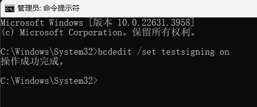
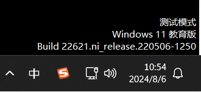
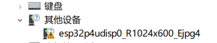
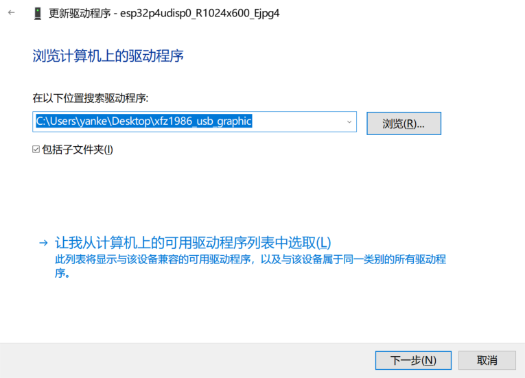
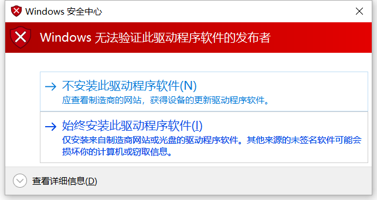
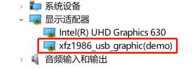

## Windows IDD Driver

The Windows Indirect Display Driver (IDD) model provides a simple user-mode driver model to support monitors that are not connected to a traditional GPU display output. [Reference](https://learn.microsoft.com/en-us/windows-hardware/drivers/display/indirect-display-driver-model-overview)

This driver is based on [chuanjinpang/win10_idd_xfz1986_usb_graphic_driver_display](https://github.com/chuanjinpang/win10_idd_xfz1986_usb_graphic_driver_display). If you need to modify it, download and recompile it yourself.

## Experimental Driver and Security Warning

> **Warning:** The prebuilt third-party driver package previously labelled "Certified Driver" is experimental. Its bundled test signatures must not be treated as Microsoft driver certification. Do not install it on production or everyday-use computers; use a disposable Windows test environment without sensitive data.

[Issue #847](https://github.com/espressif/esp-iot-solution/issues/847) reports that the installer silently adds third-party "Pikachu Test CA" / "Pikachu Trust Network CA" certificates to Windows trusted certificate stores and sets `HKLM\SOFTWARE\Policies\Microsoft\SystemCertificates\AuthRoot\DisableRootAutoUpdate` to `1`, disabling automatic trusted root updates. Trusting these certificates can allow unverified TLS certificates and code signatures to be accepted by the system. The [CA project's own notice](https://github.com/pikachuim/testca#readme) states that its certificates are for testing only and must not be used in production.

A driver signed through the official Microsoft process is being pursued; this documentation update does not replace or fix the existing installer. If you already installed it, see [Already Installed the Experimental Package?](#already-installed-the-experimental-package).

## Experimental Download

[Download the experimental driver package (read the security warning above first)](https://dl.espressif.com/AE/esp-iot-solution/xfz1986_usb_graphic_250224_rc_sign.exe)

## How to Use

### Experimental Prebuilt Driver

Only in a disposable test environment, after reviewing the security warning above, double-click the downloaded package and click Install. Installing this package changes Windows certificate trust and root update settings, not just the display driver.

### Self-Compiled Driver

Build from the upstream source and review the resulting package and signing steps. Do not reuse the prebuilt installer's CA installer. Test mode and disabled signature enforcement also reduce Windows protections, so use this procedure only on a dedicated test system. See Microsoft's [test-signing documentation](https://learn.microsoft.com/en-us/windows-hardware/drivers/install/the-testsigning-boot-configuration-option).

1. (Optional) First, disable Windows driver signature enforcement using test mode.

   * Open the command prompt as an administrator

    ```shell
    bcdedit /set testsigning on
    ```

    

    * Restart your computer. A "Test Mode" watermark will appear in the lower right corner of the desktop.

    

2. Disable Windows signature enforcement for third-party drivers, [Reference](https://answers.microsoft.com/zh-hans/windows/forum/all/%E5%AE%89%E8%A3%85%E9%A9%B1%E5%8A%A8%E7%A8%8B/de380edb-5f62-474e-9820-5663db1af086).

    * Go to `Start` --> `Settings` --> `Windows Update` --> `Recovery` --> `Advanced startup` --> `Restart now`
    * After restarting into recovery mode, click `Troubleshoot` --> `Advanced options` --> `Startup Settings` --> `Restart`
    * After restarting, select `Disable driver signature enforcement` from the startup menu and return to the desktop

3. In Device Manager, select the unrecognized device and install the driver.

    

    * Right-click and select `Update driver`
    * Choose `Browse my computer for drivers`

    

    * Select the folder directory
    * Choose `Always install this driver software`

    

4. After installation, a new display will appear under Display adapters, indicating a successful installation.

    

After testing, uninstall the test driver, run `bcdedit /set testsigning off` from an administrator command prompt, and restart Windows to leave test mode. Restore any security settings changed for testing.

## Already Installed the Experimental Package?

Uninstalling the display driver alone may leave certificate trust and root update changes behind. [Issue #847](https://github.com/espressif/esp-iot-solution/issues/847) records the affected installer SHA-256 as `268A9F8B9E7F7EF4223EE33386E6396CC1D470026188104AAD93D8B96AF52501`.

1. Uninstall the experimental display driver in Device Manager. Remove the bundled "Pikacu Test CA Truster" program if present, then check for and remove its remaining `C:\Program Files (x86)\Pikacu Test CA Truster\` folder. Do not assume the program's uninstaller restores certificate stores or policy settings.
2. With an administrator, inspect both the **Local Computer** and affected **Current User** certificate stores, including `Root` (Trusted Root Certification Authorities) and `AuthRoot` (Third-Party Root Certification Authorities). Identify the package-installed certificates and associated CRLs by their details and thumbprints before removing them. The reported root certificate SHA-1 thumbprint is `F57DF00CEB2476C8144B751F1D2D45EDBB3EDFE1`. The report describes nine certificates; removing only this root is insufficient because sub-CAs were also added as trusted roots. A complete verified thumbprint list is not yet included here; consult the issue and your system administrator to identify the remaining entries. Do not delete unrelated certificates based only on a similar name.
3. Check `HKLM\SOFTWARE\Policies\Microsoft\SystemCertificates\AuthRoot\DisableRootAutoUpdate`. If the installer added the value, remove that value to restore Windows' default automatic trusted root updates. Preserve any pre-existing organization policy and consult your administrator on managed computers. See Microsoft's [trusted root update settings](https://learn.microsoft.com/en-us/windows-server/identity/ad-cs/configure-trusted-roots-disallowed-certificates#registry-settings-modified).
4. Restart Windows and verify that the identified certificates are absent from both store locations and that automatic trusted root updates are no longer disabled by the installer. The experimental driver may stop working after its test certificates are removed; do not reinstall the CA package to restore it.

## Notes

* The device's VID and PID must match the description of `DeviceName` in the driver INF file. For composite devices, use `USB\VID_303A&PID_2986`; for display-only devices, use `USB\VID_303A&PID_2987`.

* The driver communicates with the device through the VENDOR interface, supporting multiple resolutions and image formats, controlled via the interface string descriptor. For details, refer to the [README](https://github.com/chuanjinpang/win10_idd_xfz1986_usb_graphic_driver_display/blob/main/README.md).

* The driver supports only Windows 10 and Windows 11 systems. Please test on other systems independently.
