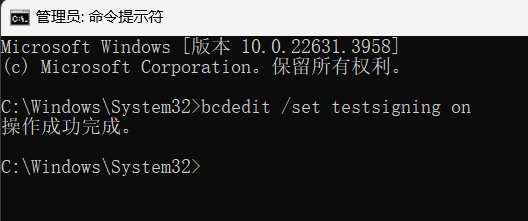
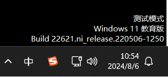
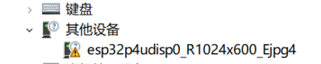
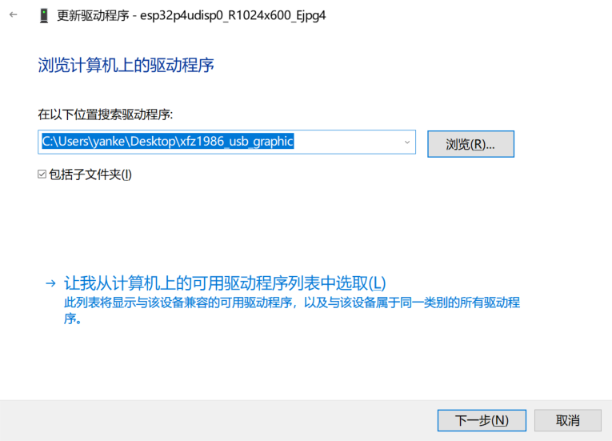
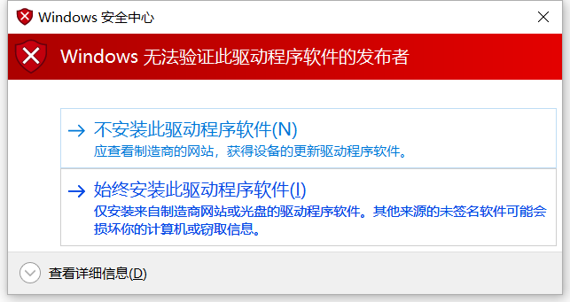
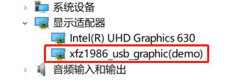

## Windows IDD 驱动程序

Windows 间接显示驱动程序 (IDD) 模型提供简单的用户模式驱动程序模型，以支持未连接到传统 GPU 显示输出的监视器。[参考](https://learn.microsoft.com/zh-cn/windows-hardware/drivers/display/indirect-display-driver-model-overview)

本驱动参考自 [chuanjinpang/win10_idd_xfz1986_usb_graphic_driver_display](https://github.com/chuanjinpang/win10_idd_xfz1986_usb_graphic_driver_display), 如需修改，请自行下载后重新编译。

## 实验性驱动与安全警告

> **警告：** 此前标为“认证驱动”的第三方预编译驱动包属于实验性软件，其附带的测试签名不代表通过了 Microsoft 驱动认证。请勿在生产环境或日常使用的电脑上安装；仅使用不含敏感数据、可随时销毁的 Windows 测试环境。

[Issue #847](https://github.com/espressif/esp-iot-solution/issues/847) 报告，该安装包会静默向 Windows 受信任证书存储区添加第三方 “Pikachu Test CA” / “Pikachu Trust Network CA” 证书，并将 `HKLM\SOFTWARE\Policies\Microsoft\SystemCertificates\AuthRoot\DisableRootAutoUpdate` 设置为 `1`，关闭受信任根证书自动更新。信任这些证书可能使系统接受未经验证的 TLS 证书和代码签名。[该 CA 项目的声明](https://github.com/pikachuim/testca#readme)明确指出，其证书仅限测试，不得用于生产环境。

我们正在推进通过 Microsoft 官方流程签名的驱动；本次文档更新并未替换或修复现有安装包。如已安装，请参阅下方的“已安装实验性驱动包的处理方法”。

## 实验性驱动下载

[下载实验性驱动包（请先阅读上方安全警告）](https://dl.espressif.com/AE/esp-iot-solution/xfz1986_usb_graphic_250224_rc_sign.exe)

## 如何使用

### 实验性预编译驱动

仅在可随时销毁的测试环境中，阅读并理解上方安全警告后，双击下载的驱动包并点击安装。该安装包除了安装显示驱动，还会修改 Windows 证书信任和根证书更新设置。

### 自行编译驱动

请从上游源码编译，并检查生成的驱动包及签名步骤，不要复用预编译安装包中的 CA 安装程序。测试模式及禁用驱动签名强制检查同样会降低 Windows 的安全防护，因此以下步骤仅限专用测试系统使用。请参阅 [Microsoft 测试签名文档](https://learn.microsoft.com/zh-cn/windows-hardware/drivers/install/the-testsigning-boot-configuration-option)。

1. (可忽略) 首先需要关掉 windows 对驱动的检查使用测试模式。

   * 使用管理员身份打开命令行 cmd

    ```shell
    bcdedit /set testsigning on
    ```

    

    * 重启电脑，桌面右下角会出现测试模式的水印

    

2. 关闭 windows 对第三方驱动的签名检查，[参考](https://answers.microsoft.com/zh-hans/windows/forum/all/%E5%AE%89%E8%A3%85%E9%A9%B1%E5%8A%A8%E7%A8%8B/de380edb-5f62-474e-9820-5663db1af086)

    * 依次点开 `开始` --> `设置` --> `windows 更新` --> `恢复` --> `高级启动` --> `立即重新启动`
    * 重启到修复模式后，点击 `疑难解答` --> `高级选项` --> `启动设置` --> `重启电脑`
    * 重启后，在启动菜单中选择 `禁用驱动程序强制签名` 重启返回桌面

3. 在设备管理器中选择未识别的设备，为其安装驱动程序
    

    * 右键选择 `更新驱动程序`
    * 选择 `游览我的电脑以查找驱动程序(R)`

    

    * 选择此文件夹目录
    * 选择 `始终安装此驱动程序软件(I)`

    

4. 安装完毕后，在显示适配器下面出现一个新的显示器，即安装成功

    

测试结束后，卸载测试驱动，使用管理员命令行执行 `bcdedit /set testsigning off`，重启 Windows 以退出测试模式，并恢复测试期间修改的安全设置。

## 已安装实验性驱动包的处理方法

仅卸载显示驱动可能不会撤销证书信任和根证书更新设置的变更。[Issue #847](https://github.com/espressif/esp-iot-solution/issues/847) 记录的受影响安装包 SHA-256 为 `268A9F8B9E7F7EF4223EE33386E6396CC1D470026188104AAD93D8B96AF52501`。

1. 在设备管理器中卸载实验性显示驱动。如存在随包安装的 “Pikacu Test CA Truster” 程序，请卸载该程序，并检查和删除其残留的 `C:\Program Files (x86)\Pikacu Test CA Truster\` 文件夹。不要假定程序卸载工具会恢复证书存储区或策略设置。
2. 请与管理员一起检查 **本地计算机** 和受影响的 **当前用户** 证书存储区，包括 `Root`（受信任的根证书颁发机构）和 `AuthRoot`（第三方根证书颁发机构）。根据证书详情及指纹确认由该安装包添加的证书及相关 CRL 后，再将其删除。报告中的根证书 SHA-1 指纹为 `F57DF00CEB2476C8144B751F1D2D45EDBB3EDFE1`。报告涉及九张证书，部分下级 CA 也被加入为受信任根证书，因此仅删除这一张根证书并不足够。本文暂未提供经过完整核实的指纹列表，请结合 issue 和系统管理员的检查确认其余条目。不要仅凭名称相似删除无关证书。
3. 检查 `HKLM\SOFTWARE\Policies\Microsoft\SystemCertificates\AuthRoot\DisableRootAutoUpdate`。如该值由安装包添加，请删除该值，恢复 Windows 默认的受信任根证书自动更新行为。保留原有组织策略；受组织管理的电脑请联系管理员处理。请参阅 [Microsoft 根证书更新设置文档](https://learn.microsoft.com/zh-cn/windows-server/identity/ad-cs/configure-trusted-roots-disallowed-certificates#registry-settings-modified)。
4. 重启 Windows，确认两个存储位置均已移除已识别的证书，且安装包不再禁用受信任根证书自动更新。删除测试证书后，实验性驱动可能无法继续工作；请勿为恢复驱动功能而重新安装 CA 包。

## 注意事项

* 设备的 VID PID 必须符合驱动文件 INF 中 `DeviceName` 的描述，对于复合设备请使用 `USB\VID_303A&PID_2986`, 对于纯显示设备请使用 `USB\VID_303A&PID_2987`。

* 该驱动通过 VENDOR 接口与设备进行通信，支持多种分辨率和图片格式，通过接口字符描述符来控制，具体参考 [README](https://github.com/chuanjinpang/win10_idd_xfz1986_usb_graphic_driver_display/blob/main/README.md)

* 驱动仅支持 windows10 及 windows11 系统，其他系统请自行测试
